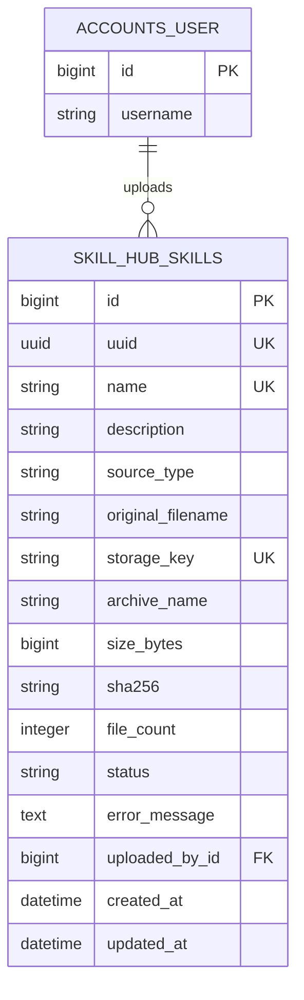

# Skill Hub 设计文档

> 当前状态：设计阶段，尚未开始代码实现。

## 1. 功能目标

Skill Hub 用于集中保存、校验、管理和分发 Agent Skill：

1. 所有登录用户都可以通过前端页面上传 Skill。
2. 支持点击选择和拖拽上传单个 `SKILL.md` 文件。
3. 支持点击选择和拖拽上传包含一个 Skill 的 `.zip`、`.tar`、`.tar.gz`、`.tgz` 压缩包。
4. 上传前校验 Skill 的结构，重点检查 frontmatter 中的 `name` 和 `description`。
5. 校验通过后，后端将内容统一规范化为 ZIP 文件，保存到指定目录，并在数据库中登记元数据。
6. 用户可以在列表中勾选多个 Skill，前端生成一段可复制的 Agent 安装提示语。
7. Agent 根据提示语自行判断自己的类型，并使用 `npx skills add <平台HTTP地址>` 下载和安装 Skill。

本平台不与 Git 仓库关联，服务端不执行 `npx skills`，也不从上游仓库拉取内容。

## 2. 非目标与边界

第一阶段不包含：

- GitHub、GitLab 或其他 Git 仓库导入。
- 服务端安装 Node.js、npm 或 `skills` CLI。
- Celery 异步导入任务。
- 一个压缩包同时导入多个 Skill。
- Skill 版本历史、覆盖上传和上游自动更新。
- 按单个 Skill 独立授权。
- 对 Skill 中的脚本进行恶意代码审计或自动执行。

“校验通过”仅表示文件结构、元数据和归档安全性满足平台要求，不代表其中的脚本或指令已经通过安全审计。

## 3. 总体流程

### 3.1 上传与校验

```text
用户点击/拖拽文件
        │
        ▼
前端基础检查：文件名、非空、大小、扩展名
        │
        ▼
POST /api/skill-hub/skills/validate/
        │
        ▼
后端完整校验，不入库、不保存正式文件
        │
        ├─ 失败：前端显示错误，禁止确认上传
        ├─ 警告：前端显示警告，允许用户确认
        └─ 通过：展示 name、description、文件数等预览
        │
        ▼
用户确认上传
        │
        ▼
POST /api/skill-hub/skills/
        │
        ▼
后端重新完整校验并规范化为 ZIP
        │
        ▼
保存文件 + 写入 ready 数据库记录
```

dry-run 校验结果只用于页面预览，正式上传时必须重新校验，防止文件被替换、请求被绕过或名称在两次请求之间发生冲突。

### 3.2 下载与安装

```text
用户勾选一个或多个 ready Skill
        │
        ▼
前端根据当前站点 origin + download_path 生成绝对 URL
        │
        ▼
前端生成通用 Agent 提示语
        │
        ▼
用户将提示语交给任意支持 Agent Skills 的 Agent
        │
        ▼
Agent 自行识别 -a 类型并执行 npx skills add
        │
        ▼
npx 从 Skill Hub 的公开内网 URL 下载 ZIP 并安装
```

## 4. 权限设计

| 操作 | 匿名用户 | 登录用户 | 上传者 | 超级管理员 |
|---|---:|---:|---:|---:|
| 查看 Skill 列表 | 否 | 是 | 是 | 是 |
| dry-run 校验 | 否 | 是 | 是 | 是 |
| 上传 Skill | 否 | 是 | 是 | 是 |
| 勾选并生成提示语 | 否 | 是 | 是 | 是 |
| 删除自己的 Skill | 否 | 仅本人记录 | 是 | 是 |
| 删除他人的 Skill | 否 | 否 | 否 | 是 |
| 下载 ready ZIP | 是，限内网 | 是 | 是 | 是 |

权限规则：

- `uploaded_by_id` 记录上传者。
- 普通用户只能删除 `uploaded_by_id = 当前用户ID` 的记录。
- 超级管理员可以删除任意记录。
- 用户被删除时，外键使用 `SET NULL`，Skill 保留；此后只有超级管理员可以管理该记录。
- 前端通过后端返回的 `can_manage` 控制删除按钮显示，但后端必须逐条重新校验所有权。
- 下载 URL 不使用登录鉴权，依赖部署环境的内网边界进行保护。

## 5. 上传格式与校验规则

### 5.1 接受的文件

单文件：

- 扩展名为 `.md`。
- 文件 basename 必须为 `SKILL.md`，上传时允许大小写差异，正式归档统一命名为 `SKILL.md`。
- 内容必须是非空、有效的 UTF-8 文本，不得包含 NUL 字节。

压缩包：

- `.zip`
- `.tar`
- `.tar.gz`
- `.tgz`
- 一个压缩包只能包含一个 Skill，即只能发现一个 `SKILL.md`。
- 允许压缩包根目录直接包含 `SKILL.md`，也允许其位于一个 Skill 目录中。
- 如果 `SKILL.md` 位于命名目录中，该目录名必须与 frontmatter 的 `name` 一致。
- 正式保存时统一整理为 `<name>/SKILL.md` 及该 Skill 的其他资源文件。

### 5.2 frontmatter 校验

`SKILL.md` 必须以 YAML frontmatter 开始：

```markdown
---
name: example-skill
description: 一个用于说明平台校验规则的示例 Skill。
---

这里编写 Skill 的具体指令。
```

校验项目：

| 项目 | 规则 | 失败处理 |
|---|---|---|
| frontmatter | 文件开头存在 `---`，且存在正确的结束分隔符 | 错误 |
| YAML | 能安全解析，顶层必须是 mapping | 错误 |
| 重复键 | 同一个 frontmatter 不允许重复定义字段 | 错误 |
| `name` | 必填，且必须是字符串 | 错误 |
| `name` 长度 | 1～64 字符 | 错误 |
| `name` 字符 | 只能包含小写字母、数字和连字符 `-` | 错误 |
| `name` 连字符 | 不能位于开头或结尾，不能连续出现 | 错误 |
| `description` | 必填，且必须是字符串 | 错误 |
| `description` 内容 | 去除首尾空白后不能为空 | 错误 |
| `description` 长度 | 1～1024 字符 | 错误 |
| Skill 目录名 | 命名目录必须与 `name` 一致 | 错误 |
| 正文 | 去除 frontmatter 后为空 | 警告 |
| 其他合法字段 | 不因存在可选字段而直接拒绝 | 保留 |

`name` 的等价正则表达式：

```text
^[a-z0-9]+(?:-[a-z0-9]+)*$
```

同时单独限制总长度不超过 64。

合法示例：

- `pdf`
- `skill-creator`
- `gitlab-review-2`

非法示例：

- `PDF`
- `skill_creator`
- `-skill-creator`
- `skill-creator-`
- `skill--creator`

后端使用安全的 YAML loader，不构造任意 Python 对象，并额外检测重复键。前端展示后端返回的字段级错误，不依赖浏览器解析结果作为最终判断。

### 5.3 文件与归档安全校验

| 限制 | 数值/规则 |
|---|---|
| 原始上传文件 | 非空且不超过 10 MiB |
| 规范化后的 ZIP | 不超过 10 MiB |
| 解压后全部文件总大小 | 不超过 25 MiB |
| 文件数量 | 不超过 1000，目录不计入文件数 |
| 路径 | 禁止绝对路径、`..`、反斜杠路径逃逸和 NUL |
| 重复路径 | 规范化后不允许重复文件路径 |
| 链接 | 禁止符号链接和硬链接 |
| 特殊文件 | 禁止设备、FIFO、socket 等 |
| 加密内容 | 不支持加密 ZIP |
| Skill 数量 | 必须且只能发现一个 `SKILL.md` |

解析压缩包时采用流式读取和累计限制，不能先将不受信任内容无限制解压到磁盘。服务端只读取和重新打包文件，不执行其中的脚本、钩子或命令。

## 6. 数据库设计

### 6.1 设计原则

第一阶段使用一张主表 `skill_hub_skills`：

- 一条记录对应一个 Skill。
- 一条记录对应一个规范化 ZIP 文件。
- 数据库保存文件元数据和存储键，不使用 BLOB 保存文件内容。
- 文件内容存入受控目录，数据库记录是列表、权限和下载定位的依据。
- 不增加 `source_url`、Git 仓库、Celery 任务或导入版本字段。

### 6.2 ER 关系



### 6.3 `skill_hub_skills` 字段

| 字段 | Django/数据库类型 | 必填 | 说明 |
|---|---|---:|---|
| `id` | `BigAutoField` / bigint PK | 是 | 内部主键，同时用于稳定下载 URL |
| `uuid` | `UUIDField` / uuid | 是 | 默认 `uuid4`，唯一，用于隔离存储目录 |
| `name` | `CharField(64)` / varchar(64) | 是 | Skill 名称，全表唯一 |
| `description` | `CharField(1024)` / varchar(1024) | 是 | 从 frontmatter 解析并去除首尾空白 |
| `source_type` | `CharField(16)` / varchar(16) | 是 | `skill_md` 或 `archive` |
| `original_filename` | `CharField(255)` / varchar(255) | 是 | 用户上传时的原始文件名，仅作展示 |
| `storage_key` | `CharField(512)` / varchar(512) | 是 | 相对存储根目录的键，唯一 |
| `archive_name` | `CharField(255)` / varchar(255) | 是 | 下载文件名，通常为 `<name>.zip` |
| `size_bytes` | `PositiveBigIntegerField` / bigint | 是 | 规范化 ZIP 的字节数，必须大于 0 |
| `sha256` | `CharField(64)` / char(64) | 是 | 规范化 ZIP 的小写 SHA-256 |
| `file_count` | `PositiveIntegerField` / integer | 是 | ZIP 内普通文件数量，必须大于 0 |
| `status` | `CharField(16)` / varchar(16) | 是 | `ready` 或 `deleting`，默认 `ready` |
| `error_message` | `TextField` / text | 否 | 删除失败等脱敏错误，默认空字符串 |
| `uploaded_by_id` | FK `settings.AUTH_USER_MODEL` | 否 | 上传者，`ON DELETE SET NULL` |
| `created_at` | `DateTimeField` / timestamptz | 是 | 创建时间，自动写入 |
| `updated_at` | `DateTimeField` / timestamptz | 是 | 最近更新时间，自动更新 |

说明：

- `uuid` 不替代数据库主键；下载 URL 使用简单的数值 `id`，文件目录使用 UUID，避免通过名称推测服务器路径。
- `original_filename` 不参与最终文件路径拼接。
- `storage_key` 只允许由后端按照 `<uuid>/<name>.zip` 生成。
- `error_message` 不保存 YAML 原文、压缩包完整路径或其他敏感内容。
- 上传校验失败不写失败记录，因此不需要 `pending`、`importing`、`failed` 等异步状态。

### 6.4 唯一约束

| 约束 | 字段 | 用途 |
|---|---|---|
| 主键 | `id` | 记录定位 |
| `uniq_skill_hub_uuid` | `uuid` | 防止存储目录重复 |
| `uniq_skill_hub_name` | `name` | 防止同名 Skill 互相覆盖 |
| `uniq_skill_hub_storage_key` | `storage_key` | 防止两个记录指向同一文件 |

同名上传返回 HTTP 409。第一阶段不提供覆盖上传，用户需要删除原记录后再上传同名 Skill。

### 6.5 Check 约束

建议添加以下数据库约束，业务层仍需提供友好的前置校验：

- `skill_hub_name_valid`：`name` 匹配 `^[a-z0-9]+(?:-[a-z0-9]+)*$`，且长度为 1～64。
- `skill_hub_description_valid`：去除首尾空白后的 `description` 长度为 1～1024。
- `skill_hub_source_type_valid`：`source_type IN ('skill_md', 'archive')`。
- `skill_hub_status_valid`：`status IN ('ready', 'deleting')`。
- `skill_hub_size_positive`：`size_bytes > 0`。
- `skill_hub_file_count_positive`：`file_count > 0`。
- `skill_hub_sha256_valid`：`sha256` 为 64 位小写十六进制字符串。

### 6.6 索引

| 索引 | 字段 | 用途 |
|---|---|---|
| `skill_hub_created_idx` | `created_at DESC, id DESC` | 默认列表稳定排序 |
| `skill_hub_status_updated_idx` | `status, updated_at` | 状态过滤和删除清理 |
| `skill_hub_uploader_created_idx` | `uploaded_by_id, created_at DESC, id DESC` | 查询当前用户上传的记录 |

`name`、`uuid`、`storage_key` 的唯一约束已提供对应索引，不重复创建。

### 6.7 状态与删除

```text
上传校验成功 → ready
ready → deleting → 删除数据库记录
deleting → deleting（文件删除失败，允许重试）
deleting → 删除数据库记录（文件不存在也视为清理成功）
```

删除步骤：

1. 在短事务中锁定记录并检查所有权，将状态改为 `deleting`。
2. 删除对应 ZIP；文件不存在视为成功。
3. 删除数据库记录。
4. 如果第 2 步失败，保留 `deleting` 和脱敏错误，允许上传者或超级管理员再次执行删除。

只有 `ready` 记录可以下载或被前端勾选，`deleting` 记录不生成安装命令。

## 7. 文件存储设计

默认目录：

```text
SKILL_HUB_ROOT=/data/skill-hub
```

Docker Compose 使用：

```text
./docker/skill-hub:/data/skill-hub
```

目录示例：

```text
docker/skill-hub/
├── .tmp/
│   └── <临时UUID>/
└── <记录UUID>/
    └── example-skill.zip
```

规则：

- 临时文件和最终文件位于同一文件系统，以便使用原子重命名。
- 正式路径只能由后端生成，解析后必须仍位于 `SKILL_HUB_ROOT` 内。
- 单个 `SKILL.md` 被包装为 `<name>/SKILL.md`。
- 压缩包被规范化为 `<name>/...` 的 ZIP，不直接原样信任上传路径。
- ZIP 创建完成后计算 `size_bytes`、`file_count` 和 `sha256`。
- 正式上传时，如果数据库写入失败，清理已保存的孤立文件。
- dry-run 只使用临时目录，并在响应前清理。
- 只有 backend 服务挂载该目录，celery-worker 不参与 Skill Hub。

## 8. API 设计

所有业务 API 使用项目现有统一响应格式；文件下载直接返回 ZIP 流。

### 8.1 列表

```http
GET /api/skill-hub/skills/?keyword=pdf&page=1&page_size=20
```

权限：登录用户。

列表项建议字段：

```json
{
  "id": 12,
  "name": "example-skill",
  "description": "示例说明",
  "source_type": "skill_md",
  "original_filename": "SKILL.md",
  "size_bytes": 1234,
  "sha256": "<64位小写哈希>",
  "file_count": 1,
  "status": "ready",
  "uploaded_by": {
    "id": 3,
    "username": "user"
  },
  "can_manage": true,
  "download_path": "/api/skill-hub/skills/12/download/",
  "created_at": "2026-01-01T00:00:00Z",
  "updated_at": "2026-01-01T00:00:00Z"
}
```

### 8.2 dry-run 校验

```http
POST /api/skill-hub/skills/validate/
Content-Type: multipart/form-data

file=<待校验文件>
```

权限：登录用户。

作用：完整校验并返回预览，不写数据库，不保留正式文件。

校验完成但存在业务错误时使用 HTTP 200 和 `valid: false`，便于前端统一展示报告；缺少文件、多个文件等请求格式错误使用 HTTP 400。

```json
{
  "valid": false,
  "name": "Example",
  "description": "示例说明",
  "file_count": 1,
  "size_bytes": 1024,
  "errors": [
    {
      "field": "name",
      "code": "invalid_name",
      "message": "name 只能包含小写字母、数字和单个连字符。"
    }
  ],
  "warnings": []
}
```

### 8.3 正式上传

```http
POST /api/skill-hub/skills/
Content-Type: multipart/form-data

file=<待上传文件>
```

权限：登录用户。

- 必须重新执行完整校验，不信任 dry-run 结果。
- 成功返回 HTTP 201 和 ready 记录。
- 校验失败返回 HTTP 400 及错误列表。
- 同名冲突返回 HTTP 409。
- 文件超限返回 HTTP 413。

### 8.4 删除

```http
DELETE /api/skill-hub/skills/<id>/
```

权限：上传者或超级管理员。

### 8.5 下载

```http
GET /api/skill-hub/skills/<id>/download/
HEAD /api/skill-hub/skills/<id>/download/
```

权限：内网公开。

响应：

- `Content-Type: application/zip`
- `Content-Disposition: attachment; filename="<name>.zip"`
- `Content-Length: <size_bytes>`
- `ETag: "<sha256>"`

仅 `ready` 可下载，不使用上游跳转，不把服务器文件路径暴露给客户端。

## 9. 前端页面设计

新增顶层页面 `/skill-hub`，所有登录用户可访问。

### 9.1 上传区域

使用 `NUpload + NUploadDragger`：

- 单次只处理一个文件，`max = 1`。
- 支持点击选择和拖拽文件。
- `accept` 包含 `.md,.zip,.tar,.tar.gz,.tgz`。
- 选择后先检查扩展名、文件非空和 10 MiB 上限。
- 基础检查通过后自动调用 dry-run 接口。
- 显示“校验中 / 校验通过 / 有警告 / 校验失败”状态。
- 展示解析出的 `name`、`description`、文件数、原始文件名和大小。
- 错误按字段展示，例如 `name 不能包含大写字母`。
- 只有 `errors` 为空时才允许点击“确认上传”。
- 用户重新选择文件后，作废旧校验请求和旧结果，避免慢响应覆盖新文件状态。
- 正式上传期间禁用重复选择和提交。

### 9.2 列表区域

- 支持按名称和描述搜索。
- 展示名称、描述、上传者、文件大小、上传时间和状态。
- 只有 ready 记录显示复选框。
- 支持跨分页保留已选记录。
- 已选记录被删除或状态改变后自动从选择集合移除。
- 根据 `can_manage` 显示删除按钮。
- 上传成功后刷新列表，并优先展示新记录。

### 9.3 提示语弹窗

- 展示已选 Skill 数量。
- 生成完整提示语和逐条安装命令。
- 提供一键复制。
- 下载 URL 使用 `window.location.origin + download_path`，适配当前访问域名和端口。
- 不提供 Agent 类型下拉框，由接收提示语的 Agent 自行判断。

示例提示语：

```text
请为当前项目安装以下 Agent Skills：

1. example-skill
2. another-skill

执行前，请先识别你当前所属的 Agent 类型，并映射为 npx skills 支持的 -a 参数。
如果无法确定，请先询问我，不要盲目选择。
只在当前项目中安装，不要使用 -g，也不要改用其他下载来源。

请依次执行：
npx skills add "https://example.internal/api/skill-hub/skills/12/download/" -a "<你识别出的Agent类型>" -y
npx skills add "https://example.internal/api/skill-hub/skills/15/download/" -a "<你识别出的Agent类型>" -y

安装完成后，请检查对应 Skill 目录及 SKILL.md 是否存在，并报告每个 Skill 的安装结果。
```

名称和描述不拼接为 shell 参数；命令中的 URL 由平台根据数值 ID 生成。

## 10. 后端模块建议

新增 `backend/skill_hub/`：

| 文件 | 职责 |
|---|---|
| `models.py` | Skill 主表、约束、索引和上传者关系 |
| `serializers.py` | 列表输出、上传输入和 `can_manage` |
| `validators.py` | `SKILL.md`、frontmatter、name、description 和错误报告 |
| `archives.py` | ZIP/TAR 安全读取、路径规范化、文件限制 |
| `storage.py` | 临时目录、规范化 ZIP、哈希、原子保存和删除 |
| `services.py` | dry-run、正式上传、所有权和删除事务 |
| `views.py` | 列表、校验、上传、删除和下载 |
| `urls.py` | `/api/skill-hub/` 路由 |
| `pagination.py` | 列表分页 |
| `admin.py` | Django Admin 只读排查和基础管理 |
| `migrations/` | 初始表结构迁移 |
| `tests/` | 模型、校验、归档、API、权限和存储测试 |

需要新增固定版本的 Python YAML 安全解析依赖；不需要修改 Celery，不需要在 backend Dockerfile 中安装 Node。

## 11. 错误与安全要求

- 所有上传接口要求登录，但下载按内网公开设计。
- 后端不能信任文件扩展名、MIME、前端校验或 dry-run 结果。
- 原始文件名只用于展示，不参与路径拼接。
- 不使用 `extract()`、`extractall()` 直接解压不受信任归档。
- 不执行上传内容中的任何脚本或命令。
- 解析 YAML 时使用安全 loader，并拒绝重复键。
- 日志不记录完整 Skill 正文、服务器绝对路径或上传内容。
- 校验失败时清理临时目录。
- 数据库失败时清理未登记的正式文件。
- 同名检查和唯一约束共同处理并发上传冲突。
- Nginx 当前 21 MiB 请求体上限大于平台 10 MiB 上传限制，无需为本功能扩大。

## 12. 测试与验收

### 12.1 后端测试

- 合法和非法的 `name`、`description`。
- 缺失 frontmatter、非法 YAML、重复 YAML 键。
- UTF-8、NUL、空文件和空正文警告。
- 单个 `SKILL.md` 规范化。
- 四种压缩格式成功上传。
- 多 `SKILL.md`、目录名不匹配、加密 ZIP。
- 路径逃逸、绝对路径、重复路径、符号链接、硬链接和特殊文件。
- 原始大小、解压大小、文件数量和规范化 ZIP 大小限制。
- dry-run 不写数据库、不留下正式文件。
- 正式上传重新校验、重名冲突和数据库失败清理。
- 普通用户上传、越权删除、上传者删除和超级管理员删除。
- ready/deleting 下载权限、公开下载和文件缺失处理。

### 12.2 前端测试

- 点击和拖拽选择文件。
- 扩展名、空文件和大小预检。
- 校验中、通过、警告和失败状态。
- `name`、`description` 预览及字段错误展示。
- 重新选择文件后旧请求不能覆盖新结果。
- 只有校验通过才能正式上传。
- ready 多选、跨分页选择和提示语复制。
- 上传者、非上传者和超级管理员的按钮差异。

### 12.3 端到端验收

1. 普通登录用户拖拽上传一个合法的 `SKILL.md`。
2. 修改 `name` 为大写，确认前端展示校验错误且不能上传。
3. 上传缺少 `description` 的压缩包，确认后端拒绝。
4. 上传包含资源文件的合法 ZIP，确认列表显示 ready。
5. 勾选两个 Skill，复制生成的提示语。
6. 使用提示语中的平台 URL，在客户端临时项目执行：

   ```bash
   npx skills add "<平台下载URL>" -a universal -y
   ```

7. 确认 `.agents/skills/<name>/SKILL.md` 安装成功。
8. 确认平台服务端没有执行该 CLI，整个上传和分发过程不依赖 Git。
