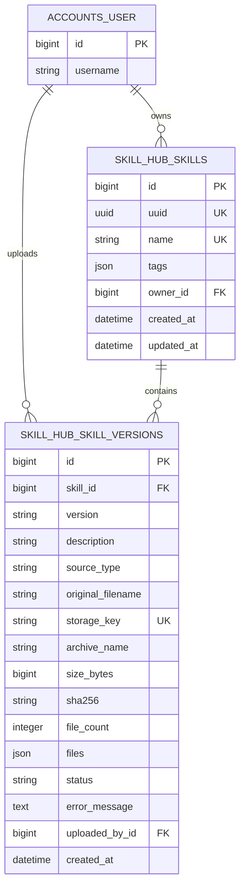

# Skill Hub 设计文档

> 当前状态：已实现，包含上传校验、版本与标签管理、公开 HTTP Discovery 及前端安装提示语。

## 1. 功能目标

Skill Hub 用于集中保存、校验、管理和分发 Agent Skill，并对外提供遵循 Agent Skills Discovery 规范的 HTTP 源：

1. 所有登录用户都可以通过前端 Skill 管理页面上传 Skill。
2. 支持点击选择和拖拽上传单个 `SKILL.md` 文件；单文件不含其他资源，带脚本、模板等资源的 Skill 需使用压缩包上传。
3. 支持点击选择和拖拽上传包含一个 Skill 的 `.zip`、`.tar`、`.tar.gz`、`.tgz` 压缩包。
4. `name` 和 `description` 由后端从上传内容中读取：单个 `SKILL.md` 直接解析，压缩包先定位其中唯一的 `SKILL.md` 再解析 frontmatter，并做格式校验（YAML 合法性、name/description 规则），不允许手动填写。上传时先 dry-run 预检并展示预览，正式上传由后端重新完整校验，不信任预检结果。
5. 校验通过后，后端将内容统一规范化为 ZIP 文件，保存到指定目录，并在数据库中登记元数据。
6. 每个 Skill 支持版本管理：上传时由用户自行指定版本号（不强制语义化版本），同一 Skill 可多次上传后续版本；版本号在同一 Skill 内唯一，同版本不可覆盖，最新上传的 ready 版本作为发布版本（当前版本）对外分发。
7. 每个 Skill 可携带一组标签，标签在上传时由用户填写（可随新版本更新），列表支持按标签筛选。
8. 平台在站点根路径暴露公开、无鉴权的发现端点 `/.well-known/skills/index.json`，返回全部 ready Skill 发布版本的 `name`、`description` 和文件清单；`npx skills add <站点地址> --list` 即可列出平台上的全部 Skill。
9. 用户可以在列表中搜索、查看和勾选多个 Skill，前端生成一段可复制的 Agent 安装提示语；提示语包含源地址和 `--skill` 名单，Agent 识别自身类型后执行 `npx skills add <站点地址> --skill <名称>...`，由 CLI 通过 HTTP 逐个拉取发布版本的 `SKILL.md` 及资源文件完成安装。
10. 每个 ready Skill 同时提供公开的 ZIP 下载地址（发布版本或指定历史版本），供手动下载与调试；上传者可删除自己的 Skill 或其中的版本，超级管理员可删除全部。

本平台不与 Git 仓库关联，服务端不执行 `npx skills`，也不从上游仓库拉取内容。Skill 的发现和下载全部通过 HTTP 完成。

> 发现与下载端点对外开放且不做鉴权：任何能访问站点的人都可以枚举并下载全部 Skill，上传内容应视为公开信息。上传、删除等管理操作仍要求登录。

## 2. 非目标与边界

第一阶段不包含：

- GitHub、GitLab 或其他 Git 仓库导入。
- 服务端安装 Node.js、npm 或 `skills` CLI。
- Celery 异步导入任务。
- 一个压缩包同时导入多个 Skill。
- 同版本号覆盖上传和上游自动更新；版本号不强制遵循语义化版本规范，由用户自行管理。
- 按单个 Skill 独立授权。
- 对 Skill 中的脚本进行恶意代码审计或自动执行。

“校验通过”仅表示文件结构、元数据和归档安全性满足平台要求，不代表其中的脚本或指令已经通过安全审计。

## 3. 总体流程

### 3.1 上传与校验

```text
用户点击/拖拽文件
        │
        ▼
前端基础检查：文件名、非空、大小、扩展名
        │
        ▼
POST /api/skill-hub/skills/validate/
        │
        ▼
后端完整校验，不入库、不保存正式文件
        │
        ├─ 失败：前端显示错误，禁止确认上传
        ├─ 警告：前端显示警告，允许用户确认
        └─ 通过：展示 name、description、文件数等预览
        │
        ▼
用户填写版本号和标签后确认上传（已有 Skill 的新版本仅上传者或超管可提交）
        │
        ▼
POST /api/skill-hub/skills/（file + version + tags）
        │
        ▼
后端重新完整校验并规范化为 ZIP
        │
        ▼
保存文件 + 写入 ready 版本记录（同 Skill 同版本号冲突返回 409）
```

dry-run 校验结果只用于页面预览，正式上传时必须重新校验，防止文件被替换、请求被绕过或名称在两次请求之间发生冲突。版本号不参与 dry-run，同版本冲突在正式上传时由唯一约束判定。

### 3.2 发现、下载与安装

平台在站点根路径实现 Agent Skills Discovery 规范，`npx skills add <站点地址>` 会优先请求 `/.well-known/skills/index.json` 完成发现，再按 `name` 逐个拉取文件；发现失败时 CLI 才回退为直接下载 URL。

```text
用户勾选一个或多个 ready Skill
        │
        ▼
前端根据当前站点 origin 生成源地址和提示语（含 --skill 名单）
        │
        ▼
用户将提示语交给任意支持 Agent Skills 的 Agent
        │
        ▼
Agent 自行识别 -a 类型并执行 npx skills add <源地址> --skill <名称>...
        │
        ▼
CLI GET /.well-known/skills/index.json 发现全部 Skill
        │
        ▼
CLI 按 --skill 名单逐个 GET /.well-known/skills/<name>/SKILL.md 及资源文件
        │
        ▼
安装到当前项目，lock 文件记录源地址，供 check/update 复用
```

单独执行 `npx skills add <站点地址> --list` 可以只列出平台上的全部 Skill 而不安装。

## 4. 权限设计

| 操作 | 匿名用户 | 登录用户 | 上传者 | 超级管理员 |
|---|---:|---:|---:|---:|
| 查看 Skill 列表及版本 | 否 | 是 | 是 | 是 |
| dry-run 校验 | 否 | 是 | 是 | 是 |
| 上传 Skill | 否 | 是 | 是 | 是 |
| 上传已有 Skill 的新版本 | 否 | 仅本人 Skill | 是 | 是 |
| 勾选并生成提示语 | 否 | 是 | 是 | 是 |
| 删除自己的 Skill 或版本 | 否 | 仅本人记录 | 是 | 是 |
| 删除他人的 Skill | 否 | 否 | 否 | 是 |
| 发现索引（index.json） | 是，公开 | 是 | 是 | 是 |
| 读取 SKILL.md 与资源文件 | 是，公开 | 是 | 是 | 是 |
| 下载 ready ZIP | 是，公开 | 是 | 是 | 是 |

权限规则：

- Skill 表 `owner_id` 记录首次上传者，版本表 `uploaded_by_id` 记录每个版本的实际上传人。
- 为已有 Skill 上传新版本，仅限 `owner_id = 当前用户ID` 或超级管理员，其他登录用户返回 403。
- 普通用户只能删除 `owner_id = 当前用户ID` 的 Skill 及其版本。
- 超级管理员可以上传任意 Skill 的新版本、删除任意 Skill 或版本。
- 用户被删除时，外键使用 `SET NULL`，Skill 与版本保留；此后只有超级管理员可以管理该记录。
- 前端通过后端返回的 `can_manage` 控制删除和上传新版本按钮显示，但后端必须逐条重新校验所有权。
- 发现端点与下载 URL 均不使用登录鉴权，对外开放；上传内容视为公开信息，不得包含密钥等敏感内容。

## 5. 上传格式与校验规则

### 5.1 接受的文件

单文件：

- 扩展名为 `.md`。
- 文件 basename 必须为 `SKILL.md`，上传时允许大小写差异，正式归档统一命名为 `SKILL.md`。
- 内容必须是非空、有效的 UTF-8 文本，不得包含 NUL 字节。

压缩包：

- `.zip`
- `.tar`
- `.tar.gz`
- `.tgz`
- 一个压缩包只能包含一个 Skill，即只能发现一个 `SKILL.md`。
- 允许压缩包根目录直接包含 `SKILL.md`，也允许其位于一个 Skill 目录中。
- 如果 `SKILL.md` 位于命名目录中，该目录名必须与 frontmatter 的 `name` 一致。
- 正式保存时统一整理为 `<name>/SKILL.md` 及该 Skill 的其他资源文件。

### 5.2 frontmatter 校验

`name` 和 `description` 只能从上传内容中读取：单个 `SKILL.md` 直接解析；压缩包按 5.1 规则定位唯一的 `SKILL.md` 后解析。前端仅只读展示解析结果，不允许手填或修改。

`SKILL.md` 必须以 YAML frontmatter 开始：

```markdown
---
name: example-skill
description: 一个用于说明平台校验规则的示例 Skill。
---

这里编写 Skill 的具体指令。
```

校验项目：

| 项目 | 规则 | 失败处理 |
|---|---|---|
| frontmatter | 文件开头存在 `---`，且存在正确的结束分隔符 | 错误 |
| YAML | 能安全解析，顶层必须是 mapping | 错误 |
| 重复键 | 同一个 frontmatter 不允许重复定义字段 | 错误 |
| `name` | 必填，且必须是字符串 | 错误 |
| `name` 长度 | 1～64 字符 | 错误 |
| `name` 字符 | 只能包含小写字母、数字和连字符 `-` | 错误 |
| `name` 连字符 | 不能位于开头或结尾，不能连续出现 | 错误 |
| `description` | 必填，且必须是字符串 | 错误 |
| `description` 内容 | 去除首尾空白后不能为空 | 错误 |
| `description` 长度 | 1～1024 字符 | 错误 |
| Skill 目录名 | 命名目录必须与 `name` 一致 | 错误 |
| 正文 | 去除 frontmatter 后为空 | 警告 |
| 其他合法字段 | 不因存在可选字段而直接拒绝 | 保留 |

`name` 的等价正则表达式：

```text
^[a-z0-9]+(?:-[a-z0-9]+)*$
```

同时单独限制总长度不超过 64。

合法示例：

- `pdf`
- `skill-creator`
- `gitlab-review-2`

非法示例：

- `PDF`
- `skill_creator`
- `-skill-creator`
- `skill-creator-`
- `skill--creator`

后端使用安全的 YAML loader，不构造任意 Python 对象，并额外检测重复键。前端展示后端返回的字段级错误，不依赖浏览器解析结果作为最终判断。

### 5.3 版本号规则

版本号由用户在上传时手动填写，不从 frontmatter 读取：

| 项目 | 规则 | 失败处理 |
|---|---|---|
| 必填 | 每次上传（首个版本和后续版本）都必须提供 | 错误 |
| 长度 | 1～32 字符 | 错误 |
| 字符 | 匹配 `^[A-Za-z0-9][A-Za-z0-9._-]{0,31}$`，即字母、数字、点、下划线、连字符，首字符为字母或数字 | 错误 |
| 唯一性 | 同一 Skill 内唯一，重复返回 HTTP 409 | 错误 |
| 语义 | 不强制语义化版本，不比较大小、不要求递增 | — |
| 归属 | 后续版本的 frontmatter `name` 必须等于已有 Skill 的 `name` | 错误 |

版本号会进入下载 URL 和存储文件名，因此禁止路径分隔符和其他特殊字符。当前版本约定为最新上传的 ready 版本；删除当前版本后自动回退到次新的 ready 版本。

### 5.4 标签规则

标签挂在 Skill 上（不区分版本），上传时由用户填写：

| 项目 | 规则 | 失败处理 |
|---|---|---|
| 必填性 | 可选，允许为空列表 | — |
| 数量 | 每个 Skill 不超过 20 个 | 错误 |
| 单个长度 | 去除首尾空白后 1～32 字符 | 错误 |
| 内容 | 非空字符串，不允许控制字符 | 错误 |
| 去重 | 同一 Skill 内按忽略大小写去重 | 自动处理 |
| 更新 | 上传新版本时携带 `tags` 则整体替换 Skill 的标签；未携带则保持不变 | — |

标签仅用于平台内的列表展示与筛选，不写入发现端点的 `index.json`，也不影响安装。

### 5.5 文件与归档安全校验

| 限制 | 数值/规则 |
|---|---|
| 原始上传文件 | 非空且不超过 10 MiB |
| 规范化后的 ZIP | 不超过 10 MiB |
| 解压后全部文件总大小 | 不超过 25 MiB |
| 文件数量 | 不超过 1000，目录不计入文件数 |
| 路径 | 禁止绝对路径、`..`、反斜杠路径逃逸和 NUL |
| 重复路径 | 规范化后不允许重复文件路径 |
| 链接 | 禁止符号链接和硬链接 |
| 特殊文件 | 禁止设备、FIFO、socket 等 |
| 加密内容 | 不支持加密 ZIP |
| Skill 数量 | 必须且只能发现一个 `SKILL.md` |

解析压缩包时采用流式读取和累计限制，不能先将不受信任内容无限制解压到磁盘。服务端只读取和重新打包文件，不执行其中的脚本、钩子或命令。

## 6. 数据库设计

### 6.1 设计原则

使用两张表：`skill_hub_skills`（Skill 主体）和 `skill_hub_skill_versions`（版本）：

- 一个 Skill 对应多个版本，每个版本对应一个规范化 ZIP 文件。
- 数据库保存文件元数据和存储键，不使用 BLOB 保存文件内容。
- 文件内容存入受控目录，数据库记录是列表、权限、发现和下载定位的依据。
- 不增加 `source_url`、Git 仓库或 Celery 任务字段。
- 版本号由用户上传时指定，在同一 Skill 内唯一；版本内容不可变，更新内容必须上传新版本号。
- 当前版本约定为最新上传的 ready 版本，对外也称"发布版本"，不单独维护冗余字段；删除当前版本后自动回退到次新的 ready 版本。
- 标签（`tags`）挂在 Skill 上，上传时填写，可随新版本整体更新；列表支持按标签筛选。

### 6.2 ER 关系



### 6.3 `skill_hub_skills` 字段

| 字段 | Django/数据库类型 | 必填 | 说明 |
|---|---|---:|---|
| `id` | `BigAutoField` / bigint PK | 是 | 内部主键 |
| `uuid` | `UUIDField` / uuid | 是 | 默认 `uuid4`，唯一，用于隔离存储目录 |
| `name` | `CharField(64)` / varchar(64) | 是 | Skill 名称，全表唯一，来自首个版本的 frontmatter |
| `tags` | `JSONField` / jsonb | 是 | 标签字符串列表，默认 `[]`，上传时填写，可随新版本整体替换 |
| `owner_id` | FK `settings.AUTH_USER_MODEL` | 否 | 首次上传者，`ON DELETE SET NULL` |
| `created_at` | `DateTimeField` / timestamptz | 是 | 创建时间，自动写入 |
| `updated_at` | `DateTimeField` / timestamptz | 是 | 最近更新时间，上传新版本时刷新 |

### 6.4 `skill_hub_skill_versions` 字段

| 字段 | Django/数据库类型 | 必填 | 说明 |
|---|---|---:|---|
| `id` | `BigAutoField` / bigint PK | 是 | 内部主键 |
| `skill_id` | FK `skill_hub_skills` | 是 | 所属 Skill，`ON DELETE CASCADE` |
| `version` | `CharField(32)` / varchar(32) | 是 | 用户指定的版本号 |
| `description` | `CharField(1024)` / varchar(1024) | 是 | 从该版本 frontmatter 解析并去除首尾空白，允许随版本变化 |
| `source_type` | `CharField(16)` / varchar(16) | 是 | `skill_md` 或 `archive` |
| `original_filename` | `CharField(255)` / varchar(255) | 是 | 用户上传时的原始文件名，仅作展示 |
| `storage_key` | `CharField(512)` / varchar(512) | 是 | 相对存储根目录的键，唯一 |
| `archive_name` | `CharField(255)` / varchar(255) | 是 | 下载文件名，通常为 `<name>-<version>.zip` |
| `size_bytes` | `PositiveBigIntegerField` / bigint | 是 | 规范化 ZIP 的字节数，必须大于 0 |
| `sha256` | `CharField(64)` / char(64) | 是 | 规范化 ZIP 的小写 SHA-256 |
| `file_count` | `PositiveIntegerField` / integer | 是 | ZIP 内普通文件数量，必须大于 0 |
| `files` | `JSONField` / jsonb | 是 | ZIP 内普通文件的相对路径清单（含 `SKILL.md`，以 Skill 根目录为基准），用于发现索引 |
| `status` | `CharField(16)` / varchar(16) | 是 | `ready` 或 `deleting`，默认 `ready` |
| `error_message` | `TextField` / text | 否 | 删除失败等脱敏错误，默认空字符串 |
| `uploaded_by_id` | FK `settings.AUTH_USER_MODEL` | 否 | 该版本的上传者，`ON DELETE SET NULL` |
| `created_at` | `DateTimeField` / timestamptz | 是 | 版本上传时间，自动写入 |

说明：

- `uuid` 不替代数据库主键；文件目录使用 Skill 级 UUID，避免通过名称推测服务器路径。发现端点与下载 URL 均按全局唯一的 `name`（及可选 `version`）寻址，上传新版本后 URL 保持不变。
- `original_filename` 不参与最终文件路径拼接。
- `storage_key` 只允许由后端按照 `<skill_uuid>/<version>.zip` 生成。
- 后续版本的 frontmatter `name` 必须与已有 Skill 的 `name` 一致，上传接口按 `name` 归属到对应 Skill。
- `error_message` 不保存 YAML 原文、压缩包完整路径或其他敏感内容。
- 上传校验失败不写失败记录，因此不需要 `pending`、`importing`、`failed` 等异步状态。
- Skill 的最后一个版本被删除时，同时删除 Skill 记录。

### 6.5 唯一约束

| 约束 | 字段 | 用途 |
|---|---|---|
| 主键 | 两表各自 `id` | 记录定位 |
| `uniq_skill_hub_uuid` | `skill_hub_skills.uuid` | 防止存储目录重复 |
| `uniq_skill_hub_name` | `skill_hub_skills.name` | 防止同名 Skill 互相覆盖 |
| `uniq_skill_hub_skill_version` | `(skill_id, version)` | 同一 Skill 内版本号唯一 |
| `uniq_skill_hub_storage_key` | `storage_key` | 防止两个版本指向同一文件 |

同一 Skill 的同一版本号重复上传返回 HTTP 409。版本内容不可变，需要更新时必须使用新的版本号。由于发现端点与下载 URL 按 `name` 寻址，上传新版本后源地址不变，已安装方可以通过 `npx skills update` 获取新内容。

### 6.6 Check 约束

建议添加以下数据库约束，业务层仍需提供友好的前置校验：

- `skill_hub_name_valid`：`name` 匹配 `^[a-z0-9]+(?:-[a-z0-9]+)*$`，且长度为 1～64。
- `skill_hub_version_valid`：`version` 匹配 `^[A-Za-z0-9][A-Za-z0-9._-]{0,31}$`。
- `skill_hub_description_valid`：去除首尾空白后的 `description` 长度为 1～1024。
- `skill_hub_source_type_valid`：`source_type IN ('skill_md', 'archive')`。
- `skill_hub_status_valid`：`status IN ('ready', 'deleting')`。
- `skill_hub_size_positive`：`size_bytes > 0`。
- `skill_hub_file_count_positive`：`file_count > 0`。
- `skill_hub_sha256_valid`：`sha256` 为 64 位小写十六进制字符串。

### 6.7 索引

| 索引 | 字段 | 用途 |
|---|---|---|
| `skill_hub_updated_idx` | `skill_hub_skills.updated_at DESC, id DESC` | Skill 列表稳定排序 |
| `skill_hub_owner_updated_idx` | `owner_id, updated_at DESC, id DESC` | 查询当前用户拥有的 Skill |
| `skill_hub_version_skill_created_idx` | `(skill_id, created_at DESC, id DESC)` | 版本列表和当前版本定位 |
| `skill_hub_version_status_idx` | `(status, created_at)` | 版本状态过滤和删除清理 |

`name`、`uuid`、`storage_key` 的唯一约束已提供对应索引，不重复创建。

### 6.8 状态与删除

```text
版本上传校验成功 → ready
ready → deleting → 删除版本记录
deleting → deleting（文件删除失败，允许重试）
deleting → 删除版本记录（文件不存在也视为清理成功）
```

删除单个版本的步骤：

1. 在短事务中锁定 Skill 与版本记录并检查所有权，将版本状态改为 `deleting`。
2. 删除对应 ZIP；文件不存在视为成功。
3. 删除版本记录；如果该 Skill 已无任何版本，同时删除 Skill 记录并清理其存储目录。
4. 如果第 2 步失败，保留 `deleting` 和脱敏错误，允许上传者或超级管理员再次执行删除。

删除整个 Skill 时，将其全部版本置为 `deleting` 后按上述步骤逐个清理。

只有 `ready` 版本可以下载或被前端勾选；发现端点和默认下载始终指向当前版本（最新上传的 ready 版本），`deleting` 记录不生成安装命令。

## 7. 文件存储设计

默认目录：

```text
SKILL_HUB_ROOT=/data/skill-hub
```

Docker Compose 使用：

```text
./docker/skill-hub:/data/skill-hub
```

目录示例：

```text
docker/skill-hub/
├── .tmp/
│   └── <临时UUID>/
└── <SkillUUID>/
    ├── 1.0.0.zip
    └── 1.1.0.zip
```

规则：

- 临时文件和最终文件位于同一文件系统，以便使用原子重命名。
- 正式路径只能由后端生成，解析后必须仍位于 `SKILL_HUB_ROOT` 内。
- 单个 `SKILL.md` 被包装为 `<name>/SKILL.md`。
- 压缩包被规范化为 `<name>/...` 的 ZIP，不直接原样信任上传路径。
- ZIP 创建完成后计算 `size_bytes`、`file_count` 和 `sha256`。
- 正式上传时，如果数据库写入失败，清理已保存的孤立文件。
- dry-run 只使用临时目录，并在响应前清理。
- 只有 backend 服务挂载该目录，celery-worker 不参与 Skill Hub。
- 发现端点读取单个 `SKILL.md` 或资源文件时，直接从规范化 ZIP 中按路径提取，不在磁盘展开目录；文件清单取自 `files` 字段，与 ZIP 内的 `<name>/` 前缀一一对应。

## 8. API 设计

所有业务 API 使用项目现有统一响应格式；文件下载直接返回 ZIP 流；发现端点（8.7）按 Agent Skills Discovery 规范返回原始 JSON 或文件内容，不套用统一响应格式。

### 8.1 列表

```http
GET /api/skill-hub/skills/?keyword=pdf&tag=ci&tag=python&page=1&page_size=20
```

筛选参数：`keyword` 匹配名称和描述；`tag` 可重复传参，多个标签之间为"同时包含"关系。

权限：登录用户。

列表项建议字段：

```json
{
  "id": 12,
  "name": "example-skill",
  "description": "示例说明（取自当前版本）",
  "current_version": "1.1.0",
  "version_count": 2,
  "tags": ["ci", "python"],
  "size_bytes": 1234,
  "sha256": "<当前版本ZIP的64位小写哈希>",
  "file_count": 1,
  "status": "ready",
  "owner": {
    "id": 3,
    "username": "user"
  },
  "can_manage": true,
  "download_path": "/api/skill-hub/skills/example-skill/download/",
  "created_at": "2026-01-01T00:00:00Z",
  "updated_at": "2026-01-02T00:00:00Z"
}
```

列表项的描述、大小、哈希和文件数均取自发布版本（当前版本）；没有 ready 版本的 Skill 不返回 `download_path`，也不可勾选。`download_path`、`current_version` 等下载信息始终对应发布版本，历史版本的下载信息只在版本列表（8.4）中返回。

另提供标签集合接口 `GET /api/skill-hub/skills/tags/`（登录用户），返回全部去重标签及对应 Skill 数量，供前端筛选下拉使用。

### 8.2 dry-run 校验

```http
POST /api/skill-hub/skills/validate/
Content-Type: multipart/form-data

file=<待校验文件>
```

权限：登录用户。

作用：完整校验并返回预览，不写数据库，不保留正式文件。

校验完成但存在业务错误时使用 HTTP 200 和 `valid: false`，便于前端统一展示报告；缺少文件、多个文件等请求格式错误使用 HTTP 400。

```json
{
  "valid": false,
  "name": "Example",
  "description": "示例说明",
  "file_count": 1,
  "size_bytes": 1024,
  "errors": [
    {
      "field": "name",
      "code": "invalid_name",
      "message": "name 只能包含小写字母、数字和单个连字符。"
    }
  ],
  "warnings": []
}
```

### 8.3 正式上传

```http
POST /api/skill-hub/skills/
Content-Type: multipart/form-data

file=<待上传文件>
version=<用户指定的版本号>
tags=<标签，重复表单字段或 JSON 字符串数组，可选>
```

权限：登录用户；如果 frontmatter 的 `name` 已存在，仅该 Skill 的 owner 或超级管理员可以上传新版本。

- 必须重新执行完整校验，不信任 dry-run 结果。
- `name` 不存在时创建 Skill 记录并写入首个版本；已存在时校验所有权后追加版本，后续版本的 `name` 必须与已有 Skill 一致。
- `name`、`description` 一律从上传文件的 frontmatter 解析，不接受请求参数覆盖；首个版本携带 `tags` 时写入 Skill 标签，上传新版本携带 `tags` 时整体替换 Skill 标签，未携带则保持不变。
- 成功返回 HTTP 201 和 ready 版本记录。
- 校验失败（含版本号规则）返回 HTTP 400 及错误列表。
- 同一 Skill 内版本号重复返回 HTTP 409。
- 非 owner 上传已有 Skill 的新版本返回 HTTP 403。
- 文件超限返回 HTTP 413。

### 8.4 版本列表

```http
GET /api/skill-hub/skills/<name>/versions/
```

权限：登录用户。

返回该 Skill 的全部版本，按上传时间倒序。每项包含 `version`、`description`、`source_type`、`original_filename`、`size_bytes`、`file_count`、`sha256`、`files`、`status`、`uploaded_by`、`created_at`、`download_path`（指向该版本 ZIP）和 `is_current` 标记。

### 8.5 删除

```http
DELETE /api/skill-hub/skills/<name>/
DELETE /api/skill-hub/skills/<name>/versions/<version>/
```

权限：Skill 的 owner 或超级管理员。

- 删除整个 Skill 时清理其全部版本与存储目录。
- 删除指定版本时只清理该版本；删除最后一个版本后 Skill 记录一并删除。
- 删除当前版本后，当前版本自动回退到次新的 ready 版本。

### 8.6 下载

```http
GET /api/skill-hub/skills/<name>/download/
HEAD /api/skill-hub/skills/<name>/download/
GET /api/skill-hub/skills/<name>/versions/<version>/download/
HEAD /api/skill-hub/skills/<name>/versions/<version>/download/
```

权限：公开，无鉴权。

不带 `version` 时下载当前版本；带 `version` 时下载指定历史版本。

响应：

- `Content-Type: application/zip`
- `Content-Disposition: attachment; filename="<name>-<version>.zip"`
- `Content-Length: <size_bytes>`
- `ETag: "<sha256>"`

仅 `ready` 版本可下载，不使用上游跳转，不把服务器文件路径暴露给客户端。

### 8.7 发现端点（Agent Skills Discovery）

以下端点位于站点根路径，不在 `/api/` 前缀下，公开无鉴权，供 `npx skills add <站点地址>` 使用：

```http
GET /.well-known/skills/index.json
GET /.well-known/skills/<name>/SKILL.md
GET /.well-known/skills/<name>/<file-path>
```

`index.json` 响应示例：

```json
{
  "skills": [
    {
      "name": "example-skill",
      "description": "示例说明",
      "files": ["SKILL.md", "scripts/extract.py"]
    }
  ]
}
```

规则：

- 索引只包含存在 ready 版本的 Skill，按 `name` 排序；`description` 与 `files` 取自当前版本（最新上传的 ready 版本）。
- `SKILL.md` 与资源文件按 `name` 定位当前版本后从 ZIP 提取；请求的文件路径必须命中该版本的 `files` 清单，否则返回 404，避免任意路径读取。
- `SKILL.md` 使用 `text/markdown; charset=utf-8`，其他文件按扩展名推断 Content-Type，无法推断时使用 `application/octet-stream`。
- 响应携带当前版本的 `ETag: "<sha256>"` 与合理的 `Cache-Control`；Skill 不存在或没有 ready 版本时返回 404。
- 当前核实的索引字段为 `name`、`description`、`files`；CLI 对 well-known 源的 `check/update` 比较逻辑以实施时所装 CLI 版本的实测为准。

实现方式：三个端点均为 Django 视图的动态响应，服务器上不存在 `.well-known` 目录，也不生成任何静态 `index.json` 文件。

- 在 Django 根路由（`backend/urls.py`）注册 `.well-known/skills/index.json`、`.well-known/skills/<slug:name>/SKILL.md`、`.well-known/skills/<slug:name>/<path:file_path>` 三条路由，指向 `skill_hub` 的发现视图；不使用 `static()` 或任何静态目录映射。
- `index.json` 视图现场查询存在 ready 版本的 Skill 及其当前版本，用 `JsonResponse` 返回内存中构造的索引字典，不写盘、不缓存为文件。
- 文件视图按 `name` 定位当前版本，用 `zipfile` 从规范化 ZIP 中读取对应 entry 的字节内容，通过 `HttpResponse` 返回并设置 Content-Type 与 ETag；路径不在该版本 `files` 清单内或读取失败时返回 404。
- Nginx 只将 `/.well-known/skills/` 反向代理转发到 backend，不在前端静态层拦截，也不映射静态目录。

## 9. 前端页面设计

新增顶层页面 `/skill-hub`，所有登录用户可访问。

### 9.1 上传区域

使用 `NUpload + NUploadDragger`：

- 单次只处理一个文件，`max = 1`。
- 支持点击选择和拖拽文件。
- `accept` 包含 `.md,.zip,.tar,.tar.gz,.tgz`。
- 选择后先检查扩展名、文件非空和 10 MiB 上限。
- 基础检查通过后自动调用 dry-run 接口。
- 显示“校验中 / 校验通过 / 有警告 / 校验失败”状态。
- 展示解析出的 `name`、`description`、文件数、原始文件名和大小。
- 提供必填的版本号输入框；如果 `name` 已存在，提示这是为已有 Skill 上传新版本并展示已有版本号避免重复，非 owner 在前端禁用提交（后端仍会复核）。
- 提供标签输入（多选、可创建新标签），随 `version` 一并提交；`name`、`description` 只读展示解析结果，不提供编辑入口。
- 错误按字段展示，例如 `name 不能包含大写字母`。
- 只有 `errors` 为空时才允许点击“确认上传”。
- 用户重新选择文件后，作废旧校验请求和旧结果，避免慢响应覆盖新文件状态。
- 正式上传期间禁用重复选择和提交。

### 9.2 列表区域

- 支持按名称和描述搜索，并支持按标签筛选（多选，选项来自标签集合接口）。
- 展示名称、当前版本、描述（取自发布版本）、标签、上传者（owner）、版本数、文件大小、更新时间和状态。
- 每行提供"版本管理"入口，打开版本抽屉：展示全部版本的版本号、描述、上传者、大小、上传时间和 `is_current` 标记，支持下载指定版本 ZIP、删除指定版本，并通过"上传新版本"复用上传区域。
- 只有当前版本为 ready 的记录显示复选框。
- 支持跨分页保留已选记录。
- 已选记录被删除或状态改变后自动从选择集合移除。
- 根据 `can_manage` 显示删除按钮。
- 上传成功后刷新列表，并优先展示新记录。

### 9.3 提示语弹窗

提示语完全由前端生成和复制，后端不提供提示语生成接口，只通过列表（8.1）和版本列表（8.4）返回 `name`、`description`、`current_version`、`download_path` 等数据字段；源地址由前端使用 `window.location.origin` 得出。

- 展示已选 Skill 数量。
- 生成完整提示语，包含源地址、发现命令和一条带 `--skill` 名单的安装命令。
- 提供一键复制。
- 源地址使用 `window.location.origin`，适配当前访问域名和端口；如果 Agent 的执行环境无法访问该地址，需替换为其实际可访问的地址。
- 不提供 Agent 类型下拉框，由接收提示语的 Agent 自行判断。

示例提示语：

```text
请为当前项目安装 Skill Hub 上的以下 Agent Skills：

1. example-skill
2. another-skill

Skill 源地址（HTTP，无需 Git）：https://homeops.example.com
全部 Skill 索引：https://homeops.example.com/.well-known/skills/index.json

执行前，请先识别你当前所属的 Agent 类型，并映射为 npx skills 支持的 -a 参数。
如果无法确定，请先询问我，不要盲目选择。
只在当前项目中安装，不要使用 -g，也不要改用其他下载来源。

请执行：
npx skills add "https://homeops.example.com" --skill example-skill --skill another-skill -a "<你识别出的Agent类型>" -y

如需先查看平台上的全部可用 Skill，可执行：
npx skills add "https://homeops.example.com" --list

安装完成后，请检查对应 Skill 目录及 SKILL.md 是否存在，并报告每个 Skill 的安装结果。
```

名称和描述不拼接为 shell 参数；`--skill` 名单中的名称均已通过 `^[a-z0-9]+(?:-[a-z0-9]+)*$` 校验，源地址由平台生成。

提示语始终基于当前版本；需要安装历史版本时，使用版本抽屉中的指定版本 ZIP 下载地址手动安装。

## 10. 后端模块建议

新增 Django app `backend/skill_hub/`，Skill Hub 的模型、方法和接口全部在该 app 内实现，使用 DRF 开发，并遵循项目现有约定：

- 在 `INSTALLED_APPS` 注册 `skill_hub`；业务路由由根 `backend/urls.py` 以 `path('skill-hub/', include('skill_hub.urls'))` 挂到 `/api/` 前缀下，发现端点三条路由在根路由直接注册并指向 app 内视图。
- 视图使用 DRF `APIView`，业务接口沿用 `ApiResponseMixin` 与 `ok()` 统一响应；列表使用 `PageNumberPagination` 子类（与 knowledge 一致的分页结构）。
- 认证沿用全局 JWT；上传、列表等接口使用默认 `IsAuthenticated`，owner/超管校验在服务层执行；发现与下载接口显式 `AllowAny`。
- `serializers.py` 使用 DRF Serializer 输出列表、版本和上传结果；`name`、`description` 只读，来自文件解析。
- 下载与发现端点直接返回 `HttpResponse`/`JsonResponse`，不套用统一响应格式。

| 文件 | 职责 |
|---|---|
| `models.py` | Skill 主表、版本表、约束、索引和上传者关系 |
| `serializers.py` | 列表输出、上传输入和 `can_manage` |
| `validators.py` | `SKILL.md`、frontmatter、name、description、版本号、标签和错误报告 |
| `archives.py` | ZIP/TAR 安全读取、路径规范化、文件限制 |
| `storage.py` | 临时目录、规范化 ZIP、哈希、原子保存、删除和 ZIP 内单文件读取 |
| `services.py` | dry-run、正式上传、所有权、发布版本定位和删除事务 |
| `permissions.py` | owner/超级管理员判定 |
| `views.py` | 列表、标签、校验、上传、版本、删除、下载和发现端点 |
| `urls.py` | app 内 `skills/` 业务路由，根路径 `/.well-known/skills/` 在根 urls.py 注册 |
| `pagination.py` | 列表分页 |
| `admin.py` | Django Admin 只读排查和基础管理 |
| `migrations/` | 初始表结构迁移 |
| `tests/` | 模型、校验、归档、API、权限和存储测试 |

需要新增固定版本的 Python YAML 安全解析依赖；不需要修改 Celery，不需要在 backend Dockerfile 中安装 Node。

## 11. 错误与安全要求

- 所有上传接口要求登录；发现端点与下载对外开放、无鉴权，上传内容视为公开信息。
- 后端不能信任文件扩展名、MIME、前端校验或 dry-run 结果。
- 原始文件名只用于展示，不参与路径拼接。
- 不使用 `extract()`、`extractall()` 直接解压不受信任归档。
- 不执行上传内容中的任何脚本或命令。
- 解析 YAML 时使用安全 loader，并拒绝重复键。
- 日志不记录完整 Skill 正文、服务器绝对路径或上传内容。
- 校验失败时清理临时目录。
- 数据库失败时清理未登记的正式文件。
- 同 Skill 同版本号检查和唯一约束共同处理并发上传冲突；新版本上传并发时同时校验 owner 所有权。
- Nginx 当前 21 MiB 请求体上限大于平台 10 MiB 上传限制，无需为本功能扩大。

## 12. 测试与验收

### 12.1 后端测试

- 合法和非法的 `name`、`description`。
- 版本号必填、长度与字符规则；同 Skill 同版本号 409；后续版本 name 不一致拒绝；非 owner 上传新版本 403。
- 单个 SKILL.md 与四种压缩包均能正确解析 name/description；请求参数无法覆盖解析结果。
- 标签数量/长度/去重校验；按单标签与多标签筛选；新版本携带 tags 时整体替换、未携带保持不变。
- 缺失 frontmatter、非法 YAML、重复 YAML 键。
- UTF-8、NUL、空文件和空正文警告。
- 单个 `SKILL.md` 规范化。
- 四种压缩格式成功上传。
- 多 `SKILL.md`、目录名不匹配、加密 ZIP。
- 路径逃逸、绝对路径、重复路径、符号链接、硬链接和特殊文件。
- 原始大小、解压大小、文件数量和规范化 ZIP 大小限制。
- dry-run 不写数据库、不留下正式文件。
- 正式上传重新校验、重名冲突和数据库失败清理。
- 普通用户上传、越权删除、上传者删除和超级管理员删除。
- ready/deleting 下载权限、公开下载和文件缺失处理。
- 发现索引只包含 ready 记录且字段完整；按 name 读取 SKILL.md 与资源文件；未登记路径、deleting 和不存在记录返回 404。
- 多版本上传后当前版本切换；删除当前版本后回退到次新版本；删除最后版本后清理 Skill 记录与存储目录。
- 指定版本 ZIP 下载与当前版本下载；发现索引与文件内容均取自当前版本；上传新版本后源地址保持不变。

### 12.2 前端测试

- 点击和拖拽选择文件。
- 扩展名、空文件和大小预检。
- 校验中、通过、警告和失败状态。
- `name`、`description` 预览及字段错误展示。
- 重新选择文件后旧请求不能覆盖新结果。
- 只有校验通过才能正式上传。
- ready 多选、跨分页选择和提示语复制。
- 上传者、非上传者和超级管理员的按钮差异。
- 版本号输入与已有版本提示；版本抽屉展示、指定版本下载与删除；上传新版本入口。
- 标签输入与按标签筛选；name/description 只读展示，不可编辑。

### 12.3 端到端验收

1. 普通登录用户拖拽上传一个合法的 `SKILL.md`。
2. 修改 `name` 为大写，确认前端展示校验错误且不能上传。
3. 上传缺少 `description` 的压缩包，确认后端拒绝。
4. 上传包含资源文件的合法 ZIP，确认列表显示 ready。
5. 在客户端临时项目执行 `npx skills add "<站点地址>" --list`，确认返回平台上的全部 ready Skill。
6. 勾选两个 Skill，复制生成的提示语，并执行其中的安装命令：

   ```bash
   npx skills add "<站点地址>" --skill <名称1> --skill <名称2> -a universal -y
   ```

7. 确认 `.agents/skills/<name>/SKILL.md` 安装成功，含资源文件的 Skill 资源完整。
8. 为同一 Skill 上传一个新版本号后执行 `npx skills check` / `npx skills update`，确认能通过原源地址发现并更新到新版本。
9. 确认平台服务端没有执行该 CLI，整个上传、发现和分发过程不依赖 Git。
